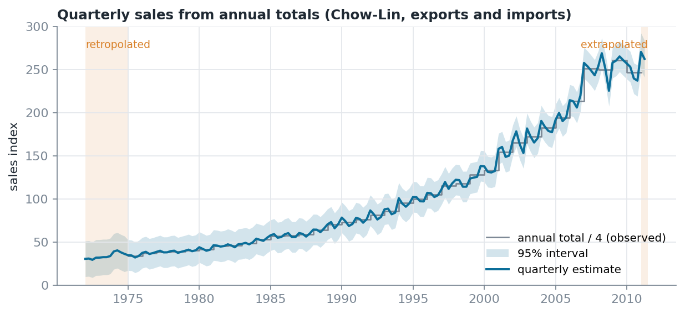
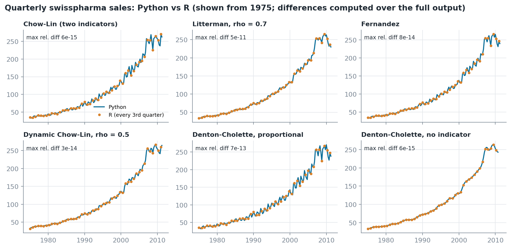

<h1 align="center">tempdisagg</h1>

<p align="center">
  <b>Temporal disaggregation of time series in Python</b><br>
  From annual to quarterly, monthly or daily — consistent with the totals, validated against R.
</p>

<p align="center">
  
  
  
  
</p>

<p align="center">
  
</p>

Official statistics often exist only once a year while analysis needs quarters or months.
`tempdisagg` estimates the high-frequency path from related indicators, and every result adds up
exactly to the published figures. It implements the methods of the R package
[`tempdisagg`](https://cran.r-project.org/package=tempdisagg) (Sax and Steiner, 2013) with the same
names and defaults, reproduces its results to machine precision, and adds what production work
usually needs: extra constraints, reconciliation of several series, backtesting and full
diagnostics.

## Installation

```bash
pip install tempdisagg            # numpy, pandas, scipy
pip install "tempdisagg[plot]"    # adds matplotlib for plotting
```

## Quick start

```python
import tempdisagg as td
from tempdisagg.datasets import load_swisspharma

sales, trade = load_swisspharma()          # annual sales, quarterly exports and imports

result = td.TemporalDisaggregator("chow-lin-maxlog").fit(sales, trade[["exports"]])
result.values                              # quarterly series
print(result.summary())                    # coefficients, rho, R², log-likelihood
result.prediction_interval(0.95)           # interval for each quarter

td.disaggregate(sales, method="denton-cholette", high_freq="Q")   # no indicator needed
```

## Methods

| Method | Idea | Presets |
|---|---|---|
| Chow-Lin | regression on the indicators, AR(1) residuals | `chow-lin-maxlog` (default), `chow-lin-minrss-ecotrim`, `chow-lin-minrss-quilis`, `chow-lin-fixed`, `fast` |
| Litterman | random-walk residuals with AR(1) changes | `litterman-maxlog`, `litterman-minrss`, `litterman-fixed` |
| Fernández | random-walk residuals | `fernandez` |
| Dynamic Chow-Lin | the target depends on its own lag (experimental) | `dynamic-maxlog`, `dynamic-minrss`, `dynamic-fixed` |
| OLS | regression without residual correlation | `ols` |
| Denton | adjusts one indicator to the totals, additive or proportional | `denton-cholette`, `denton` |
| Uniform | splits each total evenly | `uniform` |

Every method is configurable — intercept, rho criterion and bounds, truncation, Denton criterion and
order — and `describe()` lists each setting with its R equivalent:

```python
td.TemporalDisaggregator("fernandez", include_intercept=False)
td.TemporalDisaggregator("chow-lin-maxlog", truncated_rho=-1)
td.TemporalDisaggregator("denton-cholette", criterion="additive", h=2)
```

## Beyond a single series

| Need | Tool |
|---|---|
| Some quarters or months are known from another source | `constraints=td.known_values(...)` / `td.aggregate_constraints(...)` |
| Series that must add up to a total every period | `td.CrossSectionalReconciler` |
| Rates and shares (not additive) | `td.disaggregate_ratio`, or `aggregation_weights=` |
| Choosing between models and indicators | `td.backtest` |
| Structural breaks | `td.level_shift`, `td.impulse` as extra indicators |
| Incomplete years, padding of the ends | `td.CompletionSettings`, `td.PaddingSettings` |
| Non-negative output | `td.NonNegativeReconciler` |
| Methodological breaks between two versions of a series | `td.SeriesSplicer` |

Contradictory inputs are rejected with the values that clash; nothing is imputed silently; every
artificial value and every warning is recorded in the result.

## Validated against R

All 29 reference cases — every method, the four aggregation rules, with and without intercept,
Denton orders 0–2 and the Denton (1971) example — were run in R 4.5.3 with tempdisagg 1.2.0.
Predictions, coefficients, standard errors and every reported statistic agree to between 1e-13
and 3e-9. When rho is estimated, R's optimiser stops near 1e-4; the Python optimum is never worse
on the estimation criterion, and refitting at R's rho restores agreement to 1e-13.

<p align="center">
  
</p>

<p align="center">
  
</p>

The reference files are committed in `tests/reference/`, so the comparison runs with every
`pytest`. To regenerate them: `Rscript tests/reference/generate_r_reference.R`.

## Examples and data

[`examples/tempdisagg_examples.ipynb`](examples/tempdisagg_examples.ipynb) goes through every method
with real data: Chow-Lin and its variants, Denton with and without an indicator, a test against
known quarters, backtesting, known values as constraints, reconciliation of exports and imports,
rates, incomplete years and padding.

The data ship with the package:

```python
from tempdisagg.datasets import load_swisspharma, load_denton1971
```

`load_swisspharma()` returns the Swiss chemical and pharmaceutical industry data distributed with
the R package (annual sales 1975–2010; quarterly exports and imports 1972–2011; sources: Swiss
Federal Statistical Office and Federal Customs Administration). `load_denton1971()` is the
textbook example of Denton (1971).

## Input data: what to pass to the API

`tempdisagg` is a **Python API**, not an HTTP service. Its inputs represent two
frequencies:

- **`y_low`**: the observed low-frequency target (for example, *one annual total per
  year*). These are the values the estimated series must reproduce when aggregated.
- **`indicators`**: one or more higher-frequency explanatory series (for example,
  *four quarterly observations per year*). These guide the estimated path **within**
  each year; they are **not** the values to be disaggregated.

For example, an annual total of `200` for 2016 and four quarterly indicator
observations mean: **estimate four quarterly target values whose sum is 200**
(with the default `conversion="sum"`). Do not divide the annual total by four
before passing it to the model.

### Option 1 — Pandas with calendar dates (recommended)

Pass a `pandas.Series` for `y_low` and a `pandas.Series` or `pandas.DataFrame`
for `indicators`. Both must use unique, sorted **`PeriodIndex`** objects (or a
`DatetimeIndex` whose frequency pandas can infer). The target and indicators
have **different frequencies**; the calendar aligns them automatically.

```python
import numpy as np
import pandas as pd
import tempdisagg as td

# Eight annual totals: one value per year.
years = pd.period_range("2016", periods=8, freq="Y")
y_low = pd.Series(
    [200, 230, 260, 280, 315, 345, 380, 415],
    index=years,
    name="annual_total",
)

# Eight years of quarterly observations: 4 rows per year, 32 in total.
quarters = pd.period_range("2016Q1", periods=32, freq="Q")
indicators = pd.DataFrame(
    {"activity": np.linspace(30, 110, 32)},
    index=quarters,
)

result = td.TemporalDisaggregator("chow-lin-maxlog").fit(y_low, indicators)
quarterly_estimates = result.values  # pd.Series indexed by quarter
print(quarterly_estimates.head())

# Verify that the quarterly estimates reproduce the annual totals.
annual_check = quarterly_estimates.groupby(quarterly_estimates.index.asfreq("Y")).sum()
assert np.allclose(annual_check.to_numpy(), y_low.to_numpy())
```

For **multiple indicators**, supply several columns in the same quarterly
DataFrame (for example, `exports` and `employment`). A single indicator can
also be passed as a `pd.Series`. The indicator's index defines the output
frequency; `high_freq` is not needed in this case.

If your original data come in CSV files, first construct the time indexes:

```python
import pandas as pd
import tempdisagg as td

annual_csv = pd.read_csv("annual.csv")       # columns: year, total
quarterly_csv = pd.read_csv("quarterly.csv")  # year, quarter, exports, imports

y_low = pd.Series(
    annual_csv["total"].to_numpy(dtype=float),
    index=pd.PeriodIndex(annual_csv["year"].astype(str), freq="Y"),
)
quarter_index = pd.PeriodIndex(
    quarterly_csv["year"].astype(str) + "Q" + quarterly_csv["quarter"].astype(str),
    freq="Q",
)
indicators = pd.DataFrame(
    quarterly_csv[["exports", "imports"]].to_numpy(dtype=float),
    index=quarter_index,
    columns=["exports", "imports"],
)
quarterly_estimates = td.disaggregate(y_low, indicators, method="chow-lin-maxlog")
```

### Option 2 — NumPy arrays (no date index)

Use `fit_arrays()` when the observations are already in chronological order
and you know the fixed number of high-frequency periods per low-frequency
period. A one-dimensional indicator is allowed; multiple indicators use a
matrix with one column per indicator.

```python
result = td.TemporalDisaggregator("chow-lin-maxlog").fit_arrays(
    y_low.to_numpy(),             # shape (8,): eight annual observations
    indicators.to_numpy(),        # shape (32, 1): quarterly observations
    frequency_ratio=4,            # four quarters per year
)
print(result.values.head())        # indexed by integer positions, not dates
```

For monthly-to-daily or other **calendar-variable** conversions, use the
pandas interface rather than a fixed `frequency_ratio`.

### Option 3 — Long DataFrame (compatible with 0.2.x)

Use `fit_long_format()` if **each row is a high-frequency observation**.
The default column names are `Index` (low-frequency group), `Grain`
(subperiod), `y` (low-frequency target), and the indicator columns selected
by `x_cols`. For annual-to-quarterly data, the layout is:

| Index | Grain | y | activity |
|---|---:|---:|---:|
| 2016 | 1 | 200 | 30.0 |
| 2016 | 2 | 200 | 32.6 |
| 2016 | 3 | 200 | 35.2 |
| 2016 | 4 | 200 | 37.7 |
| 2017 | 1 | 230 | 40.3 |

The `y` column contains the **annual total**, repeated in the four quarter
rows (or supplied once with `NaN` in the other rows). Values within one
`Index` group must be identical when provided; conflicting totals are
rejected. The `y` column does **not** contain quarterly targets.

```python
frame = pd.DataFrame({
    "Index": np.repeat(years.year, 4),
    "Grain": np.tile([1, 2, 3, 4], len(years)),
    "y": np.repeat(y_low.to_numpy(), 4),
    "activity": indicators["activity"].to_numpy(),
})
result = td.TemporalDisaggregator("chow-lin-maxlog").fit_long_format(
    frame, x_cols=["activity"]
)
print(result.values.head())  # indexed by (Index, Grain)
```

### Without an indicator

Methods such as `uniform` and `denton-cholette` can run without explanatory
series. **Specify `high_freq`** because the desired output frequency cannot
be inferred:

```python
quarterly = td.disaggregate(y_low, method="denton-cholette", high_freq="Q")
monthly = td.disaggregate(y_low, method="uniform", high_freq="M")
```

### Rules and common mistakes

| Topic | Rule |
|---|---|
| `conversion` | Default `"sum"` reproduces totals; use `"average"`, `"first"`, or `"last"` when those definitions match the published target. |
| Dates | Pandas indexes must be sorted, unique and have known frequencies. String/date columns must be converted to a time index first. |
| Data types | Targets and indicators must be numeric; infinite values and duplicate period labels are rejected. |
| Indicator collinearity | Avoid duplicate, proportional or otherwise linearly dependent indicators; regression methods reject singular aggregated designs. |
| Missing target | `NaN` in `y_low` means that low-frequency period is **unconstrained**, not zero. |
| Missing indicator | With default `completion=True`, missing indicator observations can be filled by the documented preprocessing rules and recorded in `result.preprocessing`. Set `completion=False` to reject incomplete inputs instead. |
| API entry points | `td.disaggregate(...)` returns only a high-frequency `pd.Series`; `TemporalDisaggregator(...).fit(...)` returns a result with statistics and diagnostics. Arrays and long data use `fit_arrays()` and `fit_long_format()` respectively. |
| Additional quarters | Indicator periods beyond the final observed annual target can be estimated, but have no annual total to constrain them. |

See the [configuration guide](docs/configuration.md), [methodology](docs/methodology.md),
and [example notebook](examples/tempdisagg_examples.ipynb) for the full options.


## Documentation

| | |
|---|---|
| [Methodology](docs/methodology.md) | formulas and derivations of every method |
| [Statistics](docs/statistics.md) | every number in a result, and its R equivalent |
| [Configuration](docs/configuration.md) | settings of each method |
| [Architecture](docs/architecture.md) | how the code is organised |
| [Testing](docs/testing.md) | what each test guarantees |
| [Migration](MIGRATION.md) | changes from 0.2.x |

## Citation

```bibtex
@misc{verajaramillo2025tempdisagg,
  title         = {tempdisagg: A Python Library for Temporal Disaggregation of Time Series},
  author        = {Jaime A. Vera-Jaramillo},
  year          = {2025},
  eprint        = {2503.22054},
  archivePrefix = {arXiv},
  primaryClass  = {econ.EM}
}
```

Please also cite Sax and Steiner (2013), *Temporal Disaggregation of Time Series*,
The R Journal 5(2), 80–88, for the methods and the reference implementation.

## License

MIT. The swisspharma data come from the R package tempdisagg and Swiss official statistics.
