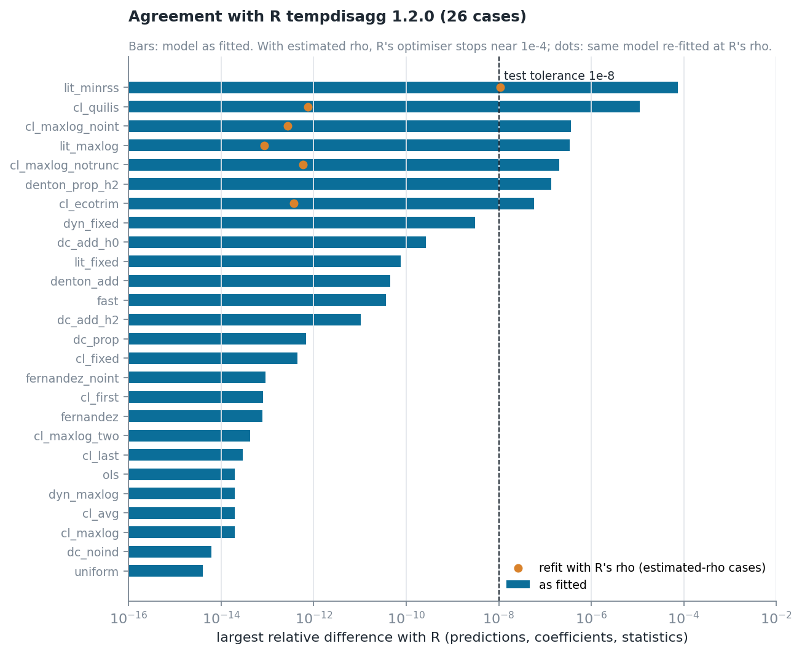
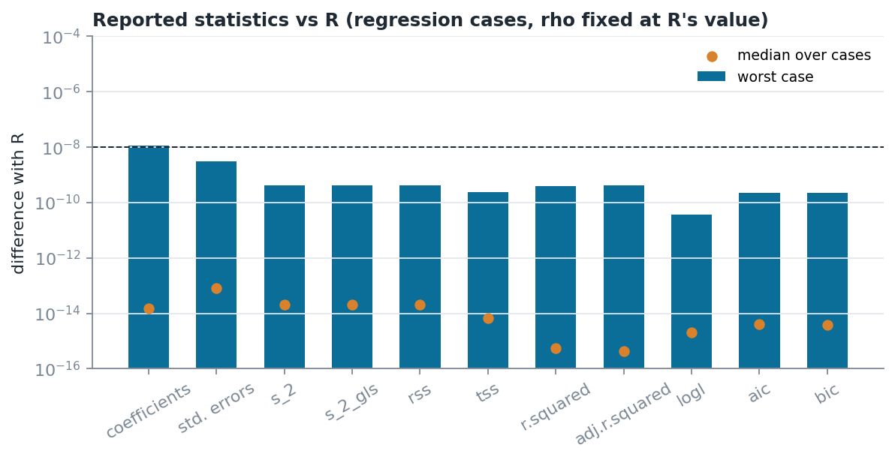

# Testing

```bash
pip install -e ".[dev]"
pytest                         # full suite (R parity is skipped without references)
Rscript tests/reference/generate_r_reference.R
TEMPDISAGG_REQUIRE_R_REFERENCE=1 pytest tests/test_r_parity.py
```

| File | What it guarantees |
|---|---|
| `test_aggregation.py` | aggregation matrix for every conversion; `temporal_aggregate` inverts a disaggregation |
| `test_data.py` | alignment, calendar awareness (days per month), rejection of gaps / missing indicators / incomplete periods |
| `test_methods.py` | every method × conversion reproduces `y_l`; Fernández ≡ Litterman(ρ=0); Denton-Cholette is the constrained minimiser (issue #4); `fast` ≈ additive Denton-Cholette; units do not change ρ |
| `test_configuration.py` | every setting of every method is configurable, validated and recorded; intercept switch for every regression method |
| `test_reference_engine.py` | optimised engine = dense textbook formulas (estimates, coefficients, covariance, prediction variance, log-likelihood, ρ optima, Denton) |
| `test_statistics.py` | Monte Carlo coverage of prediction and coefficient intervals; consistency of ML ρ; invariances; internal consistency of t, p, AIC |
| `test_robustness.py` | zero/constant/collinear indicators, exact fit, all-zero target, extreme scales, boundary ρ, malformed inputs, unidentified Denton, daily-size performance, and a 300-case randomised contract test |
| `test_r_parity.py` | values published in the R vignette, plus predictions and all statistics for 29 R cases (reference files generated with R 4.5.3 / tempdisagg 1.2.0 are committed in `tests/reference/`) |
| `test_preprocessing.py` | completion of sub-periods, gaps and indicator values; targets never invented; padding rules and removal; unconstrained padding has no in-sample effect; methods without indicators |
| `test_constraints.py` | mixed-frequency and known-value constraints hold exactly for every method; one-step GLS equals the textbook formula with stacked `C`; contradictions and redundancies; weighted rates; general non-negative projection vs a reference solver |
| `test_evaluation.py` | backtest ranking and manual refit equivalence; ratio of sums preserved; level-shift dummies; cross-sectional reconciliation (both constraint sets, minimality, inconsistent totals, partial totals) |
| `test_reconciliation.py`, `test_splicing.py`, `test_legacy.py` | utilities and backward compatibility |

**Randomised contract.** `test_random_inputs_respect_the_contract` draws random
sizes, frequency ratios, scales (1e-6 to 1e6), conversions, methods, null and
duplicated indicator columns, missing targets, missing indicator values and
padding (0–2 periods per side, every target rule) and random known values. Each fit must either return
finite values satisfying the constraint or raise a `TempDisaggError`; any other
exception or a NaN fails the test.

**R parity results.** With `rho` fixed or absent, predictions, coefficients,
standard errors and every statistic agree with R to 1e-13–3e-9. With
estimated `rho`, R's `optimize()` stops at a tolerance near 1e-4; the
Python optimum is always at least as good on the estimation criterion, and
re-fitting at R's `rho` restores agreement to 1e-13. Two documented
exceptions: original proportional Denton with h = 2 (R's solution violates its
own constraint by 2e-5; ours by 1e-13) and Litterman-minrss (slope sensitive to
the 15 digits of R's printed `rho`).





The figures are rebuilt with `python docs/make_figures.py`.

**CI.** `.github/workflows/tests.yml` runs ruff and the suite on Python
3.10–3.13. `.github/workflows/r-parity.yml` installs R and its `tempdisagg`,
generates the references and runs the parity tests with missing references
treated as failures.
